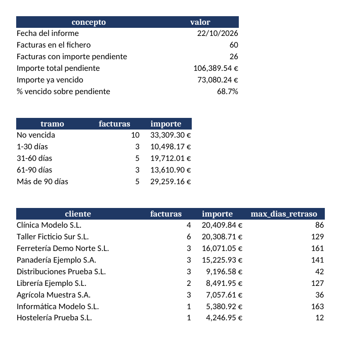

# Informe de cobros pendientes (Python + pandas → Excel)

Script que lee un listado de facturas en CSV y genera un Excel con lo que queda por cobrar: cuánto es, de qué antigüedad y qué clientes concentran la deuda.

> **Datos 100 % ficticios.** Los clientes, importes y fechas están inventados y se generan con `src/generar_datos.py`. Este proyecto es independiente de cualquier empresa real.
>
> **Desarrollado con apoyo de IA (Claude).** El código lo generó la IA a partir de un caso de uso que yo planteé. Las cifras del ejemplo se verificaron con un cálculo independiente.



## Qué hace

1. Lee `datos/facturas_ejemplo.csv` y comprueba que están las columnas necesarias.
2. Calcula el importe pendiente de cada factura (`total - importe_cobrado`), incluidos los cobros parciales.
3. Calcula los días de retraso respecto a una fecha de informe y clasifica cada factura en un tramo: *No vencida, 1-30, 31-60, 61-90, Más de 90 días*.
4. Exporta un Excel con 4 hojas:

| Hoja | Contenido |
|---|---|
| Resumen | Total pendiente, importe vencido y % vencido |
| Antigüedad | Facturas e importe por tramo de retraso |
| Por cliente | Deuda por cliente, de mayor a menor |
| Detalle | Una fila por factura pendiente, de más a menos retraso |

Un Excel ya generado está en [`ejemplo/informe_ejemplo.xlsx`](ejemplo/informe_ejemplo.xlsx).

## Cómo ejecutarlo (Windows, PowerShell)

```powershell
python -m venv .venv
.venv\Scripts\Activate.ps1
pip install -r requirements.txt
python src/informe_cobros.py --fecha 2026-10-22
```

El informe se guarda en `salida/informe_cobros.xlsx`. Sin `--fecha` usa la fecha de hoy.

Si PowerShell bloquea `Activate.ps1`, ejecuta una vez `Set-ExecutionPolicy -Scope CurrentUser RemoteSigned` y vuelve a intentarlo.

Para regenerar los datos de ejemplo: `python src/generar_datos.py`.

## Estructura

```
src/informe_cobros.py     script principal
src/generar_datos.py      generador de facturas ficticias
datos/facturas_ejemplo.csv
ejemplo/informe_ejemplo.xlsx
docs/captura_informe.png
```

## Formato del CSV de entrada

Columnas obligatorias: `num_factura`, `cliente`, `fecha_emision`, `fecha_vencimiento` (AAAA-MM-DD), `total` e `importe_cobrado`.

## Limitaciones

- Los importes se tratan como decimales de coma flotante y se redondean a 2 decimales. Para una contabilidad real habría que usar `Decimal` o céntimos enteros.
- No hay tests automáticos. Las cifras del ejemplo se verificaron a mano con un cálculo aparte.
- Una factura con `importe_cobrado` mayor que `total` (abono o error) no se marca como incidencia.

## Posibles mejoras

- Añadir tests con `pytest`.
- Avisar de facturas duplicadas o con importes negativos.
- Cruzar este informe con un extracto bancario (siguiente proyecto del portfolio).
